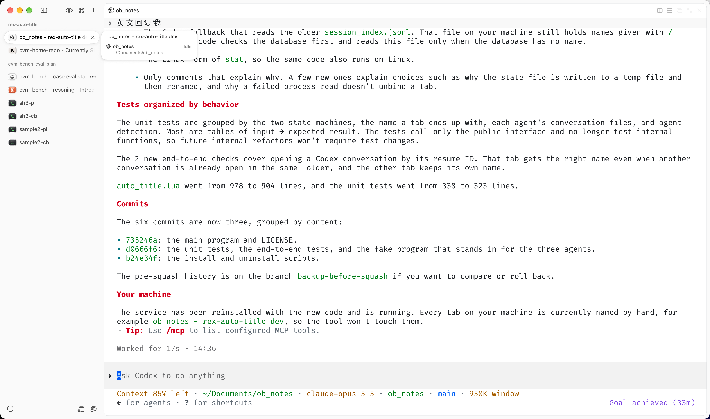

<div align="center">
  
</div>

A [Rex](https://www.superlogical.com/rex) script that names your tabs from what they are doing:
the folder, the Git branch, and the topic of a Codex, Claude Code, or pi
conversation, as `dir - branch - topic`. It follows `/rename`, `/name`, and
`/new`, leaves out the default branch, and goes back to Rex's default name in
your home folder. No LLM, no external service, and a tab you rename yourself
stays yours; clear its name to hand it back.

## Install

You need Rex on macOS or Linux, and `sqlite3` for Codex.

```sh
git clone https://github.com/Ziy1-Tan/rex-auto-title.git
cd rex-auto-title
./install.sh
```

This copies `auto_title.lua` and starts it as a login service (launchd on
macOS, a systemd user service on Linux) that renames tabs as they change. On
macOS it logs to `~/Library/Logs/rex-auto-title.log`. Rerun `./install.sh` to
update, and `./uninstall.sh` to remove it.

To run it without the service:

```sh
rex do auto_title.lua --all                # watch and rename
rex do auto_title.lua --all mode=once      # rename once
rex do auto_title.lua --all mode=dry_run   # print what each tab would be named
```

## Credits

Inspired by [herdr-auto-title](https://github.com/kryptamine/herdr-auto-title).
